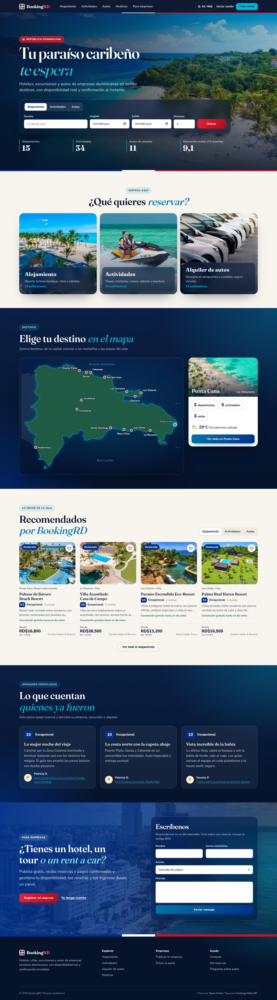
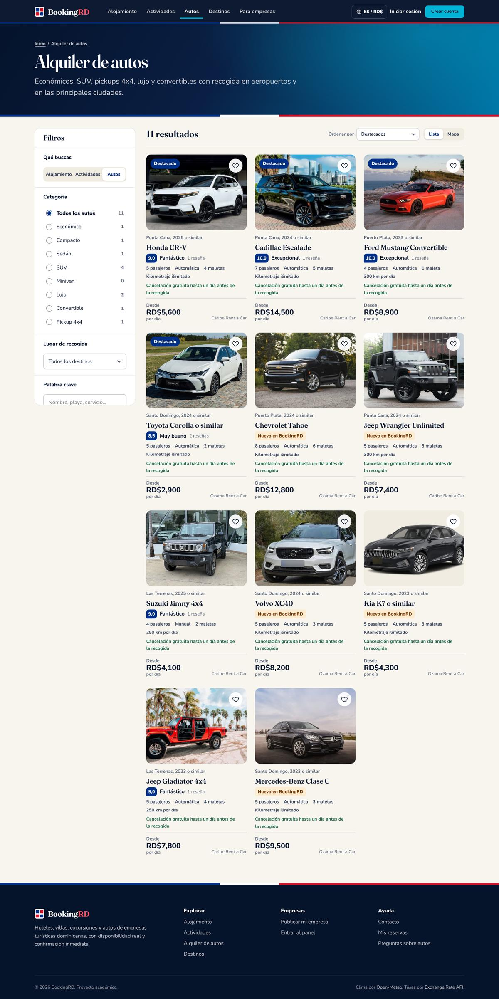
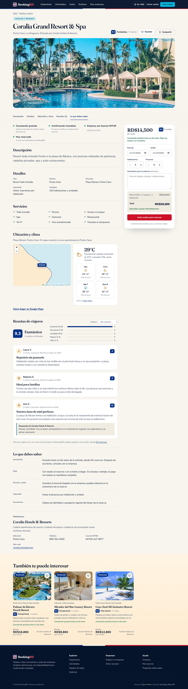
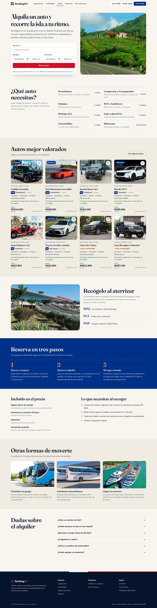
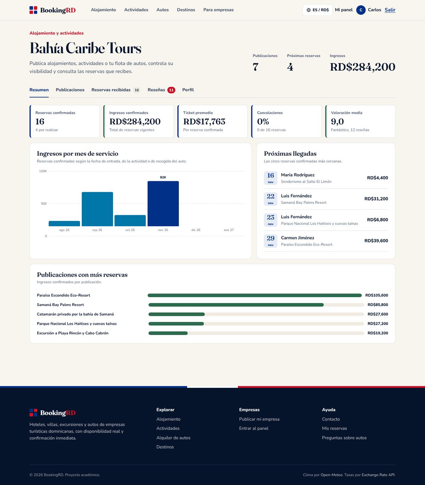
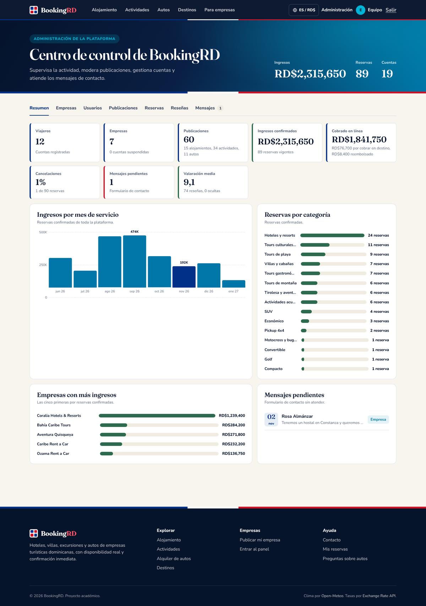
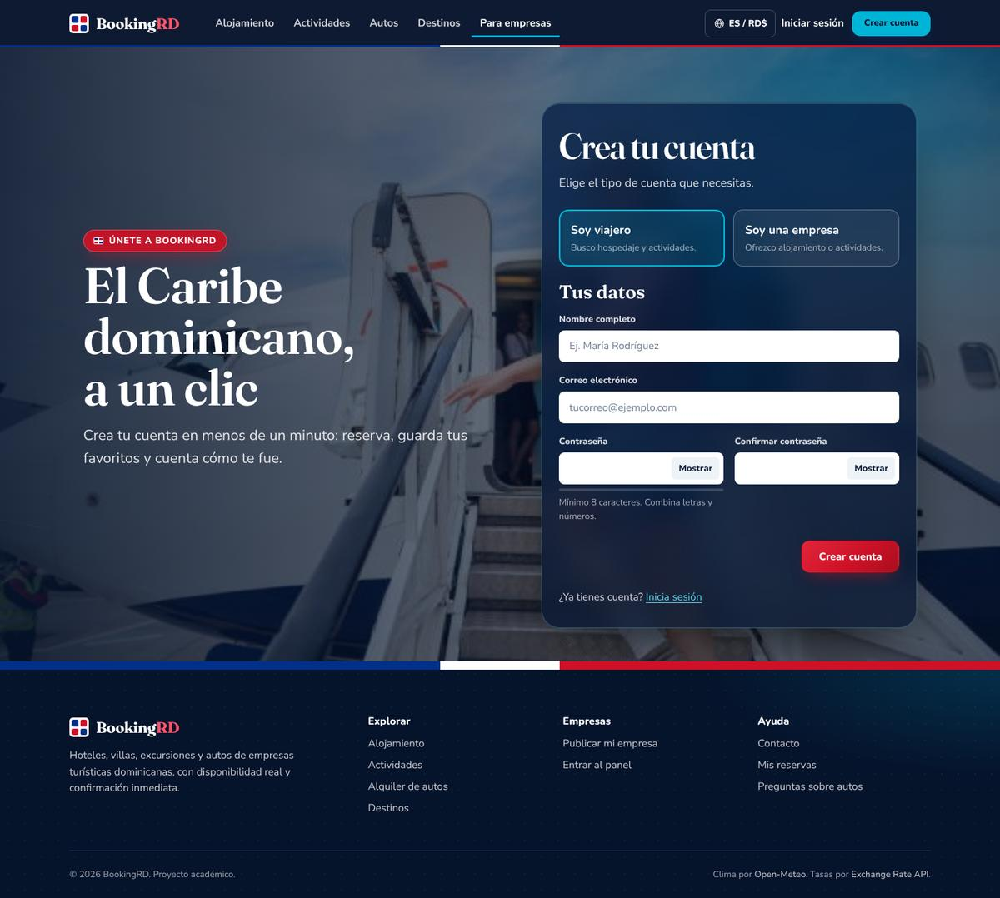
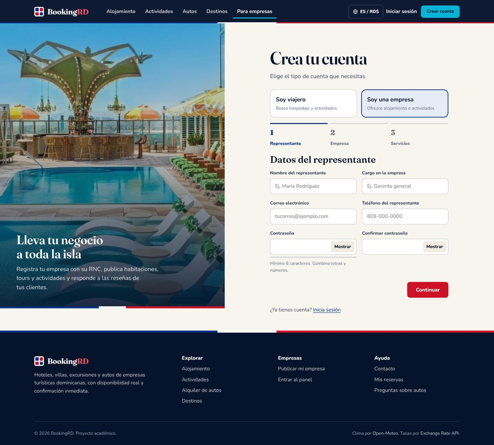

# BookingRD

Plataforma web de alojamiento, excursiones, actividades y alquiler de autos en República Dominicana. Las empresas turísticas publican sus hoteles, villas, tours y su flota de vehículos; los viajeros los encuentran, consultan la disponibilidad real y reservan. Proyecto académico.

| Capa | Tecnología |
|---|---|
| Backend | Node.js 18+ y Express 4, por capas (rutas, controladores, servicios, validadores y repositorios) |
| Base de datos | Azure SQL Database o SQL Server 2019+ mediante `mssql`; **modo de demostración en memoria** sin instalar nada |
| Frontend | HTML, CSS y JavaScript sin frameworks; una hoja de estilos por página |
| Seguridad | bcrypt, JWT, helmet, límite de intentos de acceso, consultas parametrizadas |
| Servicios externos | Clima de [Open-Meteo](https://open-meteo.com) y tasas de cambio de [ExchangeRate-API](https://www.exchangerate-api.com), ambos gratuitos y sin clave |

---

## 1. Ponerlo a funcionar en tu PC (Windows)

### 1.1 Requisitos

- **Node.js 18 o superior** (versión LTS): <https://nodejs.org>. Durante la instalación deja marcadas las opciones por defecto. Para comprobarlo, abre *Símbolo del sistema* o *PowerShell* y escribe `node -v`.
- Nada más para la demostración. SQL Server o Azure solo hacen falta para guardar los datos de forma permanente (sección 3).

### 1.2 Obtener el proyecto

Con el `.zip`: haz clic derecho sobre él, **Extraer todo**, y entra a la carpeta extraída (la que contiene `package.json`).

Con Git:

```bash
git clone https://github.com/gsanchez47-tech/BookingRD.git
cd BookingRD
```

### 1.3 Instalar y arrancar

En la carpeta del proyecto, abre una terminal (en el Explorador de archivos, escribe `cmd` en la barra de direcciones y pulsa Enter) y ejecuta:

```bash
npm install
npm start
```

Abre <http://localhost:3000> en el navegador. Para detener el servidor, pulsa `Ctrl + C` en la terminal.

Sin archivo `.env`, el servidor arranca en **modo de demostración**: carga en memoria los datos de `database/datos-demo.js` (20 cuentas, 7 empresas, 60 publicaciones, 90 reservas y 74 reseñas) y todo el sitio funciona: registrarse, reservar, cancelar, reseñar, publicar desde el panel de empresa y moderar desde la administración. Los cambios se pierden al detener el servidor. La consola lo indica al arrancar.

| Comando | Para qué |
|---|---|
| `npm start` | Arranca el servidor (demostración si no hay base configurada) |
| `npm run demo` | Fuerza el modo de demostración aunque `.env` tenga una base |
| `npm run dev` | Igual que `start`, con reinicio automático al guardar cambios |
| `npm run probar` | Pruebas automáticas de la API (24 casos) |
| `npm run construir` | Regenera `public/*.html` y `public/css/` desde `frontend/` (sección 6) |

### 1.4 Cuentas de demostración

| Rol | Correo | Contraseña |
|---|---|---|
| Viajero | cliente@bookingrd.com | Cliente123! |
| Empresa mixta (Bahía Caribe Tours) | empresa@bookingrd.com | Empresa123! |
| Empresa de alojamiento (Coralia Hotels & Resorts) | hoteles@bookingrd.com | Empresa123! |
| Alquiler de autos (Caribe Rent a Car) | autos@bookingrd.com | Empresa123! |
| Administración | admin@bookingrd.com | Admin123! |

Otros viajeros (`luis.fernandez`, `carmen.jimenez`, `ana.castillo`... todos `@correo.com`) usan `Cliente123!`; las demás empresas (`aventura@`, `montana@`, `cultura@`, `rentacar@bookingrd.com`) usan `Empresa123!`. En la página de inicio de sesión, los botones de *Cuentas de demostración* completan el formulario con un clic.

**Recorrido sugerido**

1. En el inicio, toca un destino del mapa: la ficha muestra cuántos alojamientos, actividades y autos tiene y el clima actual.
2. Entra como `cliente@bookingrd.com`, busca en *Explorar* con los filtros del panel izquierdo y reserva un hotel o una actividad.
3. Abre *Mis reservas > Reseñas* y reseña la reserva terminada que está pendiente.
4. En *Autos*, abre un vehículo, cambia la edad del conductor a 23, elige devolverlo en otra ciudad, marca un extra y mira cómo cambia el desglose.
5. Entra como `empresa@bookingrd.com`: crea una publicación con fotografía, mira la reserva recibida y responde la reseña.
6. Entra como `admin@bookingrd.com`: suspende una empresa y comprueba que sus publicaciones salen del catálogo; reactívala.
7. Cambia el idioma a inglés y la moneda a dólares con el botón *ES / RD$* del encabezado.

---

## 2. Qué incluye

| Página | Contenido |
|---|---|
| Inicio | Portada con fotografía de playa a pantalla completa, píldora roja *República Dominicana*, titular con cursiva turquesa y buscador de alojamiento, actividades o autos. **Mapa de la isla** sobre azul noche con los 15 destinos: al elegir uno, una ficha muestra sus alojamientos, actividades y autos, y el clima del momento. Banda azul con las cifras de la plataforma. Postales de 9 destinos con su fotografía, categorías, recomendados por tipo, lo visto recientemente, opiniones verificadas, *Nosotros*, llamado a empresas y contacto. |
| Explorar | **Todos los filtros en un panel a la izquierda** (cajón en móvil): qué buscas, categoría con su conteo, destino, palabra clave, personas o pasajeros, transmisión, rango de precio sobre un histograma, valoración y fechas del viaje. Etiquetas de filtros aplicados, siete órdenes, vista de lista o de mapa, clima del destino elegido y búsqueda compartible por URL. |
| Detalle | Valoración, guardar y compartir, lo más destacado, descripción, características, ubicación con clima y pronóstico, reseñas con distribución y respuesta de la empresa, lo que debes saber, relacionadas y reserva con disponibilidad y total en tiempo real. |
| Autos | Buscador con fecha y hora de recogida y devolución, tipos de auto, flota mejor valorada, cómo reservar, precio y requisitos, otras formas de moverse y preguntas frecuentes. |
| Mis reservas | Próximas, pasadas y canceladas; cancelación hasta un día antes; guardados; reseñas pendientes y publicadas. |
| Panel de empresa | Resumen con indicadores y gráficos, publicaciones con fotografía (alojamiento, actividad o vehículo), reservas recibidas con búsqueda y CSV, reseñas con respuesta pública y perfil. |
| Administración | Indicadores globales, empresas y usuarios (suspender y reactivar), moderación de publicaciones y reseñas, todas las reservas y mensajes de contacto. |
| Registro e inicio de sesión | Registro sencillo de viajero y por pasos de empresa; *Recordarme*; cada rol llega a su espacio. |

**Idioma y moneda.** El sitio está en español y se puede ver en inglés. Los precios se muestran en pesos, dólares o euros con la tasa del día (si no hay conexión, con una tasa de referencia); el pago siempre es en pesos y la reserva lo indica. Los textos escritos por usuarios y empresas no se traducen.

**Diseño caribeño.** Encabezado azul noche con la franja tricolor de la bandera; portada con fotografía de playa; cabeceras de página con el degradado del mar (azul noche a turquesa); píldoras sobre los títulos y segunda línea en cursiva turquesa; bandas azul noche, azul bandera y arena alternadas con el fondo claro. Tipografías Fraunces y Nunito (incluidas en `public/fonts/`). Una sola animación: los puntos del mapa al cargar; sin carruseles ni elementos que se desplacen solos. Cada fotografía de `public/img/` (93) se usa en un solo lugar del sitio.

**Correos.** Bienvenida al registrarse y confirmación de cada reserva por SMTP. Sin `SMTP_HOST` en `.env`, cada correo se guarda como HTML en `correos-enviados/`.

## Capturas

| Página | Escritorio | Móvil |
|---|---|---|
| Inicio |  |  |
| Explorar |  |  |
| Explorar autos |  | |
| Explorar, vista de mapa |  | |
| Detalle de alojamiento |  |  |
| Detalle de un auto |  | |
| Alquiler de autos |  |  |
| Mis reservas |  | |
| Panel de empresa |  | |
| Administración |  | |
| Inicio de sesión |  | |
| Registro de viajero |  | |
| Registro de empresa |  | |
| Correos |  | |

---

## 3. Base de datos permanente

### 3.A Azure SQL Database (recomendado para el equipo)

Una sola base compartida: lo que publica o reserva un integrante lo ven los demás. Azure SQL Database tiene una oferta gratuita (100.000 vCore-segundos y 32 GB al mes por base) con pausa automática al agotarla; es compatible con *Azure for Students* y con la cuenta gratuita de Azure.

**Crear la base (una vez, un integrante):**

1. En <https://portal.azure.com>, busca **SQL databases > Create** y selecciona **Apply offer** en el aviso de la oferta gratuita.
2. *Basics*: grupo de recursos nuevo (p. ej. `bookingrd-rg`), base `BookingRD`, servidor nuevo con **SQL authentication** (anota usuario y contraseña) y *Behavior when free limit reached*: **Auto-pause the database until next month**.
3. *Networking*: **Public endpoint** y **Add current client IP address**.
4. *Review + create > Create*.
5. En la carpeta del proyecto:

   ```bash
   npm run configurar
   ```

   El asistente pide el servidor, el usuario y la contraseña, genera `.env`, prueba la conexión (si el firewall la rechaza, indica la IP que debes autorizar) y crea las tablas con los datos de demostración.

6. Comparte el `.env` con el equipo por un canal privado. **Nunca lo subas al repositorio.**

**Resto del equipo:** copia el `.env` en la raíz del proyecto, autoriza tu IP (*SQL server > Security > Networking > Add your client IPv4 address > Save*) y verifica con `npm run bd:probar`.

Con la pausa automática, la primera conexión tras un rato sin uso puede tardar hasta un minuto. Basta con reintentar.

**Instalar a mano:** también puedes abrir `database/instalacion-azure.sql` en SSMS, en Azure Data Studio o en el *Query editor* del portal, conectado a la base `BookingRD`, y ejecutarlo completo.

### 3.B SQL Server local

1. Instala SQL Server Express o Developer y SQL Server Management Studio.
2. Abre `database/instalacion-completa.sql` en SSMS con un usuario administrador y ejecútalo (F5). Crea la base `BookingRD`, el login `bookingrd_app` (contraseña `BookingRD#2026!`), las tablas y los datos.
3. Copia la plantilla de configuración y complétala con los valores de SQL Server local que trae comentados:

   ```bash
   copy .env.example .env
   ```

   Genera un `JWT_SECRET` con `node -e "console.log(require('crypto').randomBytes(48).toString('hex'))"`.

### 3.C Comandos de base de datos

| Comando | Qué hace |
|---|---|
| `npm run bd:probar` | Prueba la conexión y cuenta los registros de cada tabla |
| `npm run bd:instalar` | Crea lo que falte y carga los datos de demostración. Idempotente: no duplica datos ni borra lo creado por el equipo |
| `npm run bd:reiniciar` | Elimina las tablas de BookingRD y las vuelve a instalar (pide confirmación). Úsalo si la base tiene tablas de una versión anterior |
| `npm run bd:generar` | Regenera los dos scripts SQL a partir de `database/esquema.sql` y `database/datos-demo.js` |

Las fechas de las reservas de ejemplo se calculan al instalar, así que siempre hay reservas próximas y un historial con reseñas.

> El script SQL se validó automáticamente (cada inserción resuelve sus claves y los conteos coinciden), pero esta versión aún no se ha ejecutado contra un SQL Server o una base de Azure reales. Ejecuta `npm run bd:instalar` y `npm run bd:probar` la primera vez y revisa la salida.

---

## 4. Configuración (`.env`)

La plantilla comentada está en `.env.example`. Variables principales:

| Variable | Uso |
|---|---|
| `DB_SERVER`, `DB_DATABASE`, `DB_USER`, `DB_PASSWORD`, `DB_PORT`, `DB_INSTANCE`, `DB_TRUST_CERT` | Conexión a la base. Sin `DB_SERVER`, modo de demostración |
| `DB_MODO=demo` | Fuerza el modo de demostración |
| `JWT_SECRET`, `JWT_EXPIRES_IN` | Firma y duración de las sesiones |
| `PORT` | Puerto del servidor (3000) |
| `LIMITE_INTENTOS_AUTH` | Intentos de inicio de sesión por IP cada 10 minutos |
| `SMTP_HOST`, `SMTP_PORT`, `SMTP_USUARIO`, `SMTP_CLAVE`, `CORREO_REMITENTE`, `URL_SITIO` | Envío de correos (Gmail: contraseña de aplicación en <https://myaccount.google.com/apppasswords>; Outlook: `smtp-mail.outlook.com`, puerto 587) |

## 5. Trabajo en equipo con GitHub

Repositorio: <https://github.com/gsanchez47-tech/BookingRD>.

```bash
git pull
git checkout -b nombre-de-rama
git add .
git commit -m "Descripción del cambio"
git push -u origin nombre-de-rama   # y abrir un Pull Request
```

Fuera del repositorio (`.gitignore`): `node_modules/`, `.env`, `correos-enviados/` y registros.

## 6. Estructura

```
BookingRD/
├── frontend/                 Fuente de las páginas
│   ├── paginas/*.html        Contenido de cada página
│   ├── partes/               Cabeza, encabezado y pie comunes
│   └── estilos/              base.css, una hoja por página y compartidos/
├── public/                   Sitio servido por Express (generado + recursos)
│   ├── *.html, css/          Generados con npm run construir: no editar a mano
│   ├── js/                   comun.js, preferencias.js (idioma y moneda),
│   │                         idioma-en.js, isla.js (mapa SVG), clima.js,
│   │                         buscador.js, mapa.js y uno por página
│   ├── img/                  destinos/, paginas/, publicaciones/, servicios/
│   ├── fonts/                Fraunces y Nunito (licencia OFL)
│   └── vendor/leaflet/       Mapa de resultados (Leaflet 1.9.4)
├── src/
│   ├── server.js             Express: seguridad, rutas, estáticos y errores
│   ├── config/               Conexión SQL, modo de demostración y correo
│   ├── routes/ controllers/ services/ validators/ middleware/ utils/
│   └── repositories/         SQL (*.repo.js) y memoria/ (modo de demostración)
├── database/
│   ├── esquema.sql           Tablas e índices
│   ├── datos-demo.js         Datos de ejemplo (fuente única)
│   ├── instalacion-completa.sql   SQL Server local (crea base y login)
│   └── instalacion-azure.sql      Azure SQL Database
├── scripts/                  configurar, bd, demo, generar-sql, construir-frontend
├── pruebas/api.test.js       Pruebas de la API
└── docs/                     Documentación técnica, resumen y capturas
```

Para cambiar el diseño, edita `frontend/` y ejecuta `npm run construir`. Los cambios en `public/js/` no necesitan ese paso.

Documentación técnica: [`docs/DOCUMENTACION.md`](docs/DOCUMENTACION.md). Guía paso a paso de Azure: [`docs/GUIA-AZURE.md`](docs/GUIA-AZURE.md). Resumen en una página: [`docs/RESUMEN.md`](docs/RESUMEN.md).

## 7. Solución de problemas

| Síntoma | Causa probable | Qué hacer |
|---|---|---|
| `'npm' no se reconoce como un comando` | Node.js no está instalado o la terminal se abrió antes de instalarlo | Instala Node.js LTS y abre una terminal nueva |
| `Error: listen EADDRINUSE :::3000` | Ya hay un servidor en el puerto 3000 | Cierra la otra terminal o pon `PORT=3001` en `.env` |
| Aviso "El servidor de BookingRD no está en ejecución" | Se abrió un HTML con doble clic | Ejecuta `npm start` y entra a <http://localhost:3000> |
| Página sin estilos | HTML abierto desde dentro del `.zip` | Extrae el `.zip` primero |
| Clima sin datos o moneda con tasa de referencia | Sin conexión a internet o servicio externo caído | El sitio sigue funcionando; se actualiza cuando vuelva la conexión |
| "El servicio no está disponible en este momento" | Sin conexión con la base, o Azure reanudándose | Reintenta en un minuto; si sigue, `npm run bd:probar` |
| `Cannot open server ... requested by the login` | Tu IP no está autorizada en Azure | Agrégala en *Networking > Firewall rules* |
| `Login failed for user` | Usuario o contraseña incorrectos | Revisa `DB_USER` y `DB_PASSWORD` |
| `Invalid column name` tras instalar | La base tiene tablas de una versión anterior | `npm run bd:reiniciar` |
| `Failed to connect to localhost:1433` | TCP/IP deshabilitado en SQL Server Express | Habilítalo en *SQL Server Configuration Manager*, o usa `DB_INSTANCE=SQLEXPRESS` con `DB_PORT` vacío |
| "Demasiados intentos" | Límite de inicios de sesión por IP | Espera 10 minutos o sube `LIMITE_INTENTOS_AUTH` |
