# BookingRD

Plataforma web para buscar y reservar alojamiento y tours en República Dominicana, con combos de hotel y excursiones con descuento, alquiler de autos, equipo de aventura y fotógrafos, la Ruta del Parador con asistencia vial y una tienda de artesanía. Las empresas turísticas publican sus hoteles, villas, tours, equipo y flota; los viajeros los encuentran en 19 destinos, consultan la disponibilidad real y reservan. Proyecto académico.

| Capa | Tecnología |
|---|---|
| Backend | Node.js 18+ y Express 4, por capas (rutas, controladores, servicios, validadores y repositorios) |
| Base de datos | Azure SQL Database o SQL Server 2019+ mediante `mssql`; si no hay SQL Server, una base local en archivo que también guarda los datos |
| Frontend | HTML, CSS y JavaScript sin frameworks; una hoja de estilos por página |
| Seguridad | bcrypt, JWT, helmet, límite de intentos de acceso, consultas parametrizadas |
| Servicios externos | Clima, amanecer, índice UV y estado del mar de [Open-Meteo](https://open-meteo.com); tasas de cambio de [ExchangeRate-API](https://www.exchangerate-api.com); feriados de [Nager.Date](https://date.nager.at); resumen de los destinos de Wikipedia; mapas de [OpenStreetMap](https://www.openstreetmap.org) con Esri de respaldo. Todos gratuitos y sin clave |

---

## 1. Ponerlo a funcionar en tu PC (Windows)

### 1.1 Obtener el proyecto

Con el `.zip`: haz clic derecho sobre él, **Extraer todo**, y entra a la carpeta extraída (la que contiene `INICIAR-BookingRD.bat`). No lo ejecutes desde dentro del `.zip`.

Con Git:

```bash
git clone https://github.com/gsanchez47-tech/BookingRD.git
cd BookingRD
```

### 1.2 Instalación completa en un equipo nuevo (recomendado)

Haz doble clic en **`INSTALAR-BookingRD.bat`** y pulsa **Sí** cuando Windows pida permiso de administrador. Hace todo con comandos, sin preguntas (`scripts/instalar-windows.ps1`):

1. Instala **Node.js LTS** con `winget` si falta.
2. Usa el **SQL Server** que ya tenga el equipo o instala **SQL Server 2022 Express** sin ventanas.
3. Copia BookingRD a **`C:\BookingRD`** (reemplaza una instalación anterior) e instala las dependencias.
4. Crea la base **BookingRD** con sus tablas y datos de ejemplo, habilita TCP/IP (puerto 1433; si está ocupado, usa la instancia con nombre por SQL Server Browser) y el usuario `bookingrd_app`, y escribe `.env`.
5. Comprueba desde Node.js que la aplicación lee y escribe en la base (`scripts/verificar-instalacion.js`).
6. Crea el acceso **BookingRD** en el escritorio y en el menú Inicio (con **Desinstalar BookingRD**) y abre la página.

Después, para usarla: doble clic en **BookingRD** en el escritorio. El registro completo de la instalación queda en `C:\BookingRD-instalacion.log`.

### 1.3 Arrancar sin instalar (desde la carpeta del proyecto)

Haz doble clic en **`INICIAR-BookingRD.bat`**. Se encarga de todo:

1. Si no tienes **Node.js**, lo instala con `winget` (o abre <https://nodejs.org> si tu Windows no tiene `winget`; instálalo y vuelve a hacer doble clic).
2. Instala las dependencias (`npm install`), solo la primera vez.
3. La primera vez configura **SQL Server**. Windows pide permiso de administrador: acéptalo. El instalador:
   - busca SQL Server en el equipo y, si no hay, ofrece instalar **SQL Server 2022 Express** (gratuito, unos 10 minutos);
   - habilita TCP/IP en el puerto 1433 y la autenticación de SQL Server;
   - crea la base **BookingRD** con sus tablas y los datos de ejemplo, y el usuario `bookingrd_app` con una contraseña nueva;
   - escribe el archivo `.env` con esa conexión.
4. Arranca el servidor y abre <http://localhost:3000> en el navegador.

Las siguientes veces solo arranca y abre el navegador. **No cierres la ventana negra** mientras usas la página; para apagar BookingRD, ciérrala o pulsa `Ctrl + C`.

Todo lo que se haga en la página (registros, publicaciones, reservas, reseñas, moderación) se guarda en la base de datos. **Lo único simulado son los pagos con tarjeta** (sección 1.5).

**Si no se pudo configurar SQL Server** (cancelaste el permiso, no quisiste instalarlo o dio un error), BookingRD se abre igual con una **base local en archivo** (`database/local/`), que también guarda todos los cambios entre un arranque y otro. Puedes volver a intentar SQL Server cuando quieras con `npm run sqlserver`. Si `.env` apunta a SQL Server y el servicio no responde, el arranque lo avisa y usa la base local mientras tanto.

Para ver la base en SQL Server Management Studio: servidor `localhost` (o `.\SQLEXPRESS`), autenticación de Windows, base `BookingRD`.

> **Importante:** no abras los archivos `.html` con doble clic (la barra de direcciones diría `C:/Users/.../public/index.html`). Así el navegador no habla con el servidor: los contadores salen en 0 y no se puede iniciar sesión. Entra siempre por <http://localhost:3000> con BookingRD en ejecución.

**Desde una terminal** (también en macOS o Linux, con Node.js 18+):

```bash
npm install
npm run iniciar
```

| Comando | Para qué |
|---|---|
| `npm run iniciar` | Lo mismo que el doble clic: configura SQL Server la primera vez (Windows), prueba la conexión y abre el navegador |
| `npm start` | Arranca el servidor con lo que diga `.env` (SQL Server o Azure; sin `DB_SERVER`, la base local en archivo) |
| `npm run sqlserver` | Vuelve a configurar SQL Server local y a crear la base BookingRD (Windows) |
| `npm run configurar` | Asistente para conectar con Azure SQL Database (sección 3.A) |
| `npm run local:reiniciar` | Borra la base local en archivo; el próximo arranque carga de nuevo los datos de ejemplo |
| `npm run demo` | Demostración en memoria con datos nuevos que no se guardan (no toca ninguna base) |
| `npm run dev` | Igual que `start`, con reinicio automático al guardar cambios |
| `npm run probar` | Pruebas automáticas de la API (29 casos) |
| `npm run construir` | Regenera `public/*.html` y `public/css/` desde `frontend/` (sección 6) |

Los datos de ejemplo (`database/datos-demo.js`) traen 21 cuentas, 8 empresas, 77 publicaciones (16 alojamientos, 50 actividades y servicios, 11 autos), 7 combos, 93 reservas con su pago, 74 reseñas y una tienda con 11 productos y 2 pedidos.

### 1.4 Cuentas de demostración

| Rol | Correo | Contraseña |
|---|---|---|
| Viajero | cliente@bookingrd.com | Cliente123! |
| Empresa mixta (Bahía Caribe Tours) | empresa@bookingrd.com | Empresa123! |
| Empresa de alojamiento (Coralia Hotels & Resorts) | hoteles@bookingrd.com | Empresa123! |
| Alquiler de autos (Caribe Rent a Car) | autos@bookingrd.com | Empresa123! |
| Equipo y fotógrafos (Equipo & Lente Aventura) | equipo@bookingrd.com | Empresa123! |
| Administración | admin@bookingrd.com | Admin123! |

Otros viajeros (`luis.fernandez`, `carmen.jimenez`, `ana.castillo`... todos `@correo.com`) usan `Cliente123!`; las demás empresas (`aventura@`, `montana@`, `cultura@`, `rentacar@bookingrd.com`) usan `Empresa123!`. En la página de inicio de sesión, los botones de *Cuentas de demostración* completan el formulario con un clic.

### 1.5 Tarjetas de prueba (pagos simulados)

Al reservar (una publicación o un combo) se elige pagar con tarjeta o en el destino; la tienda de artesanía solo acepta tarjeta. La pasarela es una **simulación**: no se conecta a ningún banco, no cobra nada y no guarda el número completo ni el CVV (solo la marca, los últimos 4 dígitos y el titular). Usa cualquier nombre y un vencimiento futuro; en la ventana de pago, *Tarjetas de prueba* completa el formulario con un clic.

| Número | Marca | Resultado |
|---|---|---|
| 4242 4242 4242 4242 | Visa | Aprobada |
| 5555 5555 5555 4444 | Mastercard | Aprobada |
| 3782 822463 10005 | American Express | Aprobada (CVV de 4 dígitos) |
| 4000 0000 0000 0002 | Visa | Rechazada por el banco |
| 4000 0000 0000 9995 | Visa | Fondos insuficientes |
| Un número con un dígito cambiado | | Número inválido (algoritmo de Luhn) |

### 1.6 Guion para la demostración en clase

Unos 12 minutos. Guion completo con lo que se dice en cada paso: [`docs/GUIA-DEMOSTRACION.md`](docs/GUIA-DEMOSTRACION.md).

1. **Inicio:** escribe "sam" en el destino (sugerencias con foto y número de publicaciones), muestra la *Tasa de hoy* y convierte 100 dólares a pesos, enseña los combos destacados y toca un destino del mapa (por ejemplo, Miches); la ficha muestra la foto, lo que se puede reservar, los lugares imperdibles y el clima.
2. **Explorar:** filtra con el panel izquierdo (tipo, destino, precio, valoración) y pulsa *Ver en el mapa*: lista y mapa lado a lado. Cambia entre *Normal*, *Calles* y *Satélite* en el panel de abajo y abre la pantalla completa.
3. **Reserva con pago:** entra como `cliente@bookingrd.com`, abre un hotel y pulsa *Reservar ahora*. Paga primero con `4000 0000 0000 9995` (fondos insuficientes: la reserva no se crea) y luego con `4242 4242 4242 4242`. Muestra el código de reserva y el **recibo** (se puede imprimir o guardar en PDF).
4. **Combo:** en *Combos*, filtra por Cabarete y pulsa *Arma tu combo*. Cambia la llegada y las noches: el desglose muestra el precio normal tachado, el precio del combo y el ahorro. Reserva y paga con `4242 4242 4242 4242`; se crean tres reservas, una por cada parte.
5. **Tienda:** agrega un colgante de larimar y café de Jarabacoa, elige *A domicilio* (RD$450) y paga. El pedido aparece en *Mis reservas > Pedidos* y en *Administración > Tienda*, donde se marca como enviado.
6. **En ruta:** muestra las paradas por carretera, filtra por quesos y enseña la asistencia vial: 911, *462 y grúas por provincia.
7. **Auto:** en *Autos*, cambia la edad del conductor a 23, devuélvelo en otra ciudad y marca un extra; el desglose cambia al instante. Reserva con *Pagar en el mostrador*.
8. **Mis reservas:** cancela la reserva pagada con tarjeta; el aviso confirma el **reembolso** a la Visa •••• 4242. Reseña la reserva terminada pendiente.
9. **Cuenta nueva con verificación:** en *Crear cuenta* elige *Empresa*, llena los tres pasos y pulsa *Crear cuenta*. Llega un código de 6 dígitos al correo (sin servidor de correo, *Abrir el correo* lo muestra); escríbelo y la cuenta entra a su panel. En *Publicaciones > Nueva publicación* publica una actividad: aparece al instante en *Actividades*. En *Iniciar sesión*, *¿Olvidaste tu contraseña?* envía un enlace para crear una nueva.
10. **Empresa de ejemplo:** entra como `empresa@bookingrd.com`; en *Reservas recibidas* se ve el estado del pago de cada reserva y *Marcar cobrado* registra el pago en destino de *Senderismo al Salto El Limón*.
11. **Administración:** entra como `admin@bookingrd.com`; el resumen muestra lo cobrado en línea, lo pendiente y lo reembolsado. Suspende una empresa y comprueba que sus publicaciones salen del catálogo; reactívala.
12. **Idioma y moneda:** cambia a inglés y dólares con *ES / RD$*; en el mismo menú, *Otro idioma* traduce la página a cualquier idioma. Paga una reserva eligiendo *Dólares estadounidenses*: el recibo muestra US$, la tasa y el equivalente en pesos.

Para empezar la demostración con los datos originales: con SQL Server, `npm run bd:reiniciar` (o `npm run sqlserver` y responder *s* a crear la base de nuevo); con la base local, cierra BookingRD y ejecuta `npm run local:reiniciar`. Si prefieres ensayar sin tocar la base, `npm run demo` usa datos en memoria que se descartan al cerrar.

---

## 2. Qué incluye

| Página | Contenido |
|---|---|
| Inicio | En orden: portada con fotografía de playa, buscador sobre vidrio (sugerencias con foto y número de publicaciones) y cifras; **tasa de hoy** del dólar y el euro con conversor a pesos; *¿Qué quieres reservar?* (alojamiento, actividades o autos); franja de garantías (pago protegido, cancelación gratuita, empresas verificadas, reseñas reales); **combos destacados** con forma de boleto (itinerario por días y precio con el ahorro); **mapa de la isla** con relieve, autopistas, aeropuertos y los 19 destinos y una ficha con la foto del destino, lo que tiene, sus lugares imperdibles y el clima; *Más para tu viaje* (equipo, fotógrafos, Ruta del Parador y tienda); experiencias por categoría con su conteo; recomendados por tipo; *Tu viaje en tres pasos*; opiniones verificadas; llamado a empresas con el formulario de contacto. |
| Combos | Paquetes de alojamiento y una o dos actividades del mismo destino con descuento (10 a 15 %). Filtros a la izquierda (destino y orden), itinerario por días, ventana *Arma tu combo* con llegada, noches, personas y habitaciones, desglose con el precio normal tachado, disponibilidad real de cada parte y reserva con un solo pago. Cada parte queda como una reserva con su código, marcada como combo en *Mis reservas*. |
| Explorar | Mini mapa con *Ver en el mapa* y **todos los filtros en un panel a la izquierda** (cajón en móvil): qué buscas, categoría con su conteo, destino, palabra clave, personas o pasajeros, transmisión, rango de precio sobre un histograma, valoración y fechas del viaje. Etiquetas de filtros aplicados, siete órdenes, vista de lista o de mapa (lista y mapa lado a lado, marcadores con precio agrupados, vistas Normal, Calles y Satélite en un panel abajo y pantalla completa), clima del destino elegido y búsqueda compartible por URL. |
| Detalle | Valoración, guardar y compartir, lo más destacado, descripción, características, ubicación con clima y pronóstico, reseñas con distribución y respuesta de la empresa, lo que debes saber, relacionadas y reserva con disponibilidad y total en tiempo real. |
| Equipo y fotógrafos | Dos categorías nuevas de actividades: alquiler de equipo de aventura (camping, abrigos, snorkel, paddleboard, chalecos, neveritas) y fotógrafos y pilotos de dron. Se reservan por unidades (equipos o sesiones) en lugar de por personas. |
| En ruta | Ruta del Parador: paradas para comer en la Autopista Duarte, la Autovía del Este, la Carretera Sánchez y la costa norte, con filtros por carretera y antojo. Asistencia vial con llamada directa al 911 y al *462, grúas por provincia (red de ejemplo) y un botón que copia un enlace con tu ubicación. |
| Tienda | Artesanía certificada (larimar, ámbar, arte taíno, café y cacao, muñecas Limé y máscaras de carnaval) con filtros a la izquierda, carrito, entrega gratis en el hotel o a domicilio, pago con tarjeta simulado, cancelación mientras no se envía y seguimiento desde la administración. |
| Autos | Buscador con fecha y hora de recogida y devolución, tipos de auto, flota mejor valorada, cómo reservar, precio y requisitos, otras formas de moverse y preguntas frecuentes. |
| Pago (simulado) | Ventana de pago al reservar: tarjeta (vista previa de la tarjeta, validación de número, vencimiento y CVV, tarjetas de prueba, respuesta del "banco") o pago en el destino. Recibo imprimible con referencia y código de autorización. |
| Mis reservas | Próximas, pasadas y canceladas; estado del pago y recibo de cada reserva; cancelación hasta un día antes con reembolso automático del pago con tarjeta; guardados; reseñas pendientes y publicadas; pedidos de la tienda. Las partes de un combo llevan la etiqueta del combo. |
| Panel de empresa | Resumen con indicadores y gráficos, publicaciones con fotografía (alojamiento, actividad o vehículo), reservas recibidas con estado del pago, *Marcar cobrado* para pagos en destino, búsqueda y CSV, reseñas con respuesta pública y perfil. |
| Administración | Indicadores globales (incluye cobrado en línea, por cobrar y reembolsado), empresas y usuarios (suspender y reactivar), moderación de publicaciones y reseñas, todas las reservas con su pago, pedidos de la tienda (enviar y entregar) y mensajes de contacto. |
| Registro e inicio de sesión | Registro sencillo de viajero y por pasos de empresa, **con código de verificación de 6 dígitos enviado al correo**; *¿Olvidaste tu contraseña?* envía un enlace de un solo uso (30 minutos) para crear una nueva; *Recordarme*; cada rol llega a su espacio. Una cuenta de empresa publica alojamientos, actividades o autos desde su panel y aparecen al instante en el catálogo. |

**Idioma y moneda.** El sitio está en español, con traducción propia y revisada al inglés, y se puede ver en cualquier otro idioma (francés, portugués, alemán, italiano, criollo haitiano, chino, japonés, árabe y unos 45 más) con la traducción automática de Google, que se carga solo al elegirlo y necesita internet; si no carga, la página vuelve al español con un aviso. Los nombres propios y los textos de usuarios y empresas no se traducen. Los precios se muestran en pesos, dólares o euros con la tasa del día (si no hay conexión, con una tasa de referencia). **El pago se hace en pesos dominicanos o en dólares**: en la ventana de pago se elige la moneda; en dólares se cobra el total convertido con la tasa del día y el recibo muestra el importe cobrado, el equivalente en pesos y la tasa aplicada. El pago en el destino se registra en pesos.

**Diseño caribeño y futurista.** Azules profundos del Caribe de noche con paneles de vidrio translúcido, bordes de luz y brillos turquesa; fotografías a pantalla completa bajo un velo azul (inicio, inicio de sesión, registro, empresas y categorías de Explorar); encabezado azul noche con la franja tricolor; píldoras sobre los títulos y segunda línea en cursiva turquesa; retícula de puntos en las bandas oscuras. Tipografías Fraunces y Nunito (incluidas en `public/fonts/`). Una sola animación: los puntos del mapa al cargar; sin carruseles ni elementos que se desplacen solos. Cada fotografía de `public/img/` (135) se usa en un solo lugar del sitio, incluidos el equipo de aventura, los fotógrafos y los productos de la tienda (`public/img/productos/`).

**Correos.** Código de verificación al registrarse, enlace para restablecer la contraseña, bienvenida y confirmación de cada reserva por SMTP. Sin `SMTP_HOST` en `.env` (modo de demostración), cada correo se guarda como HTML en `correos-enviados/` y la propia página muestra *Abrir el correo* para verlo y copiar el código. Para que lleguen a Gmail de verdad, pon en `C:\BookingRD\.env` `SMTP_HOST=smtp.gmail.com`, `SMTP_PORT=465`, `SMTP_USUARIO` y `SMTP_CLAVE` (contraseña de aplicación) y vuelve a abrir BookingRD.

## Capturas

| Página | Escritorio | Móvil |
|---|---|---|
| Inicio |  |  |
| Combos | 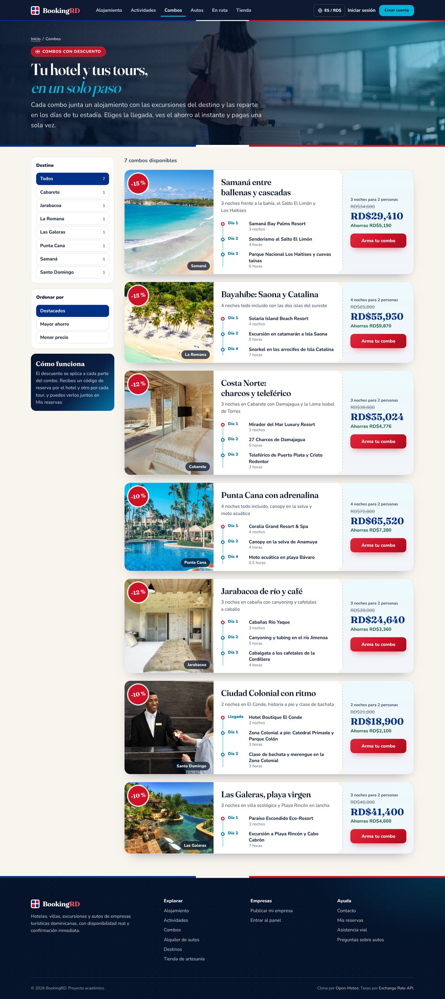 | 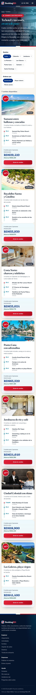 |
| Tienda de artesanía | 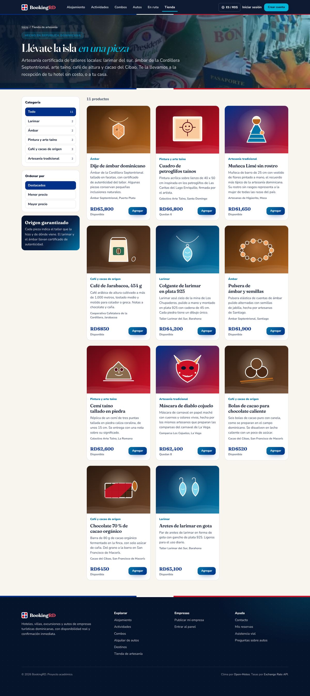 | 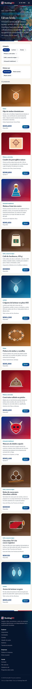 |
| Ruta del Parador | 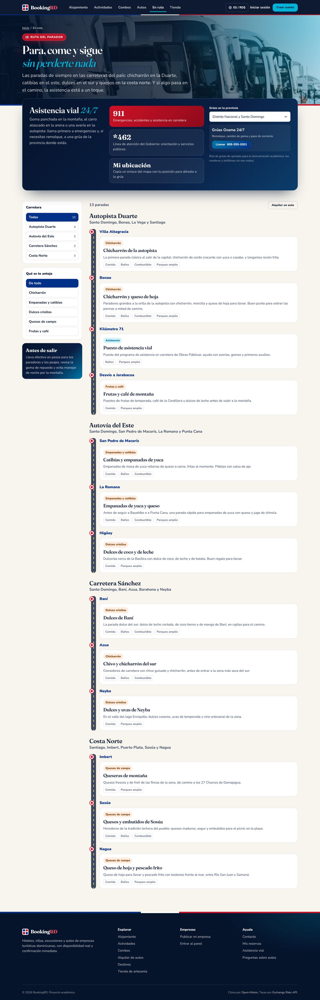 | |
| Explorar | 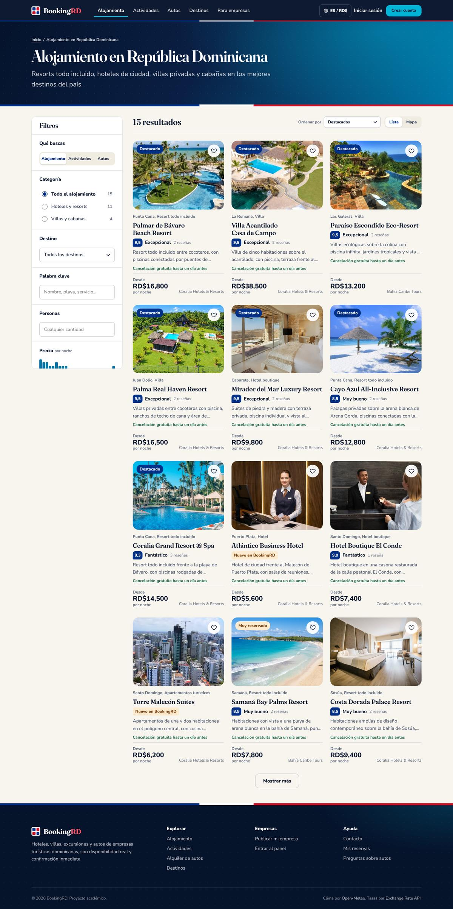 | 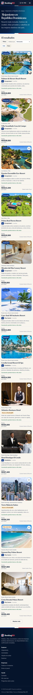 |
| Explorar autos |  | |
| Explorar, vista de mapa | 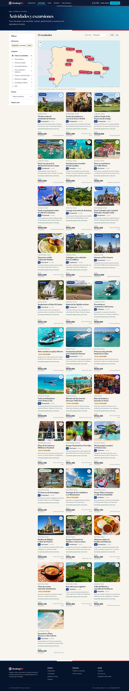 | |
| Detalle de alojamiento |  | 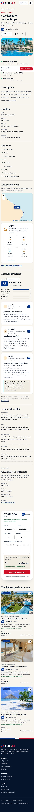 |
| Detalle de un auto | 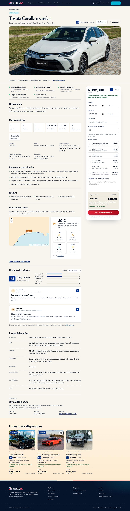 | |
| Pago simulado | 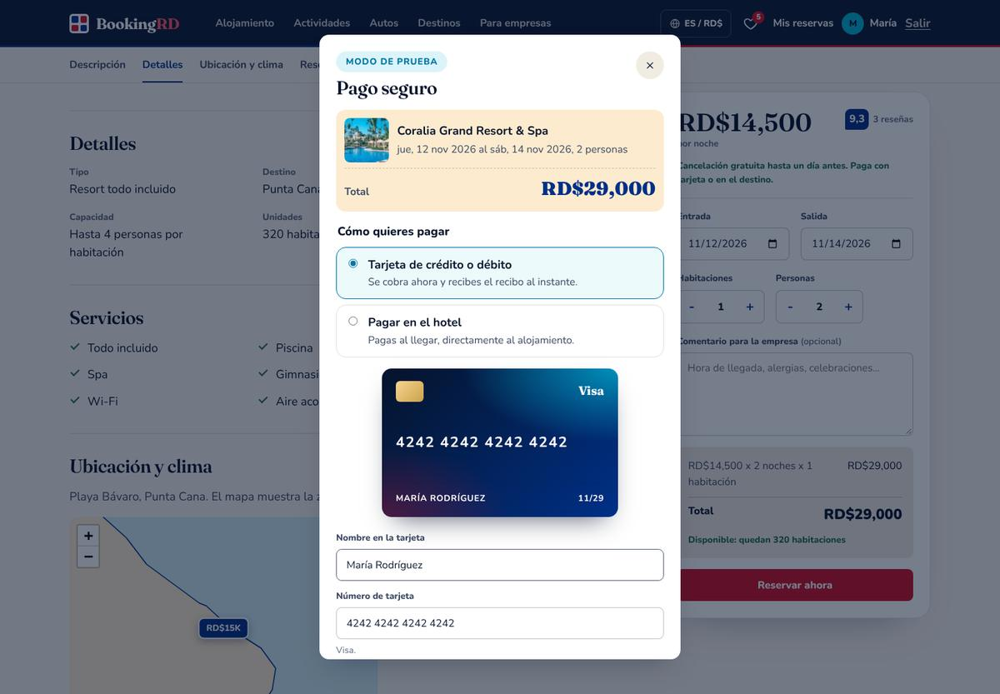 | 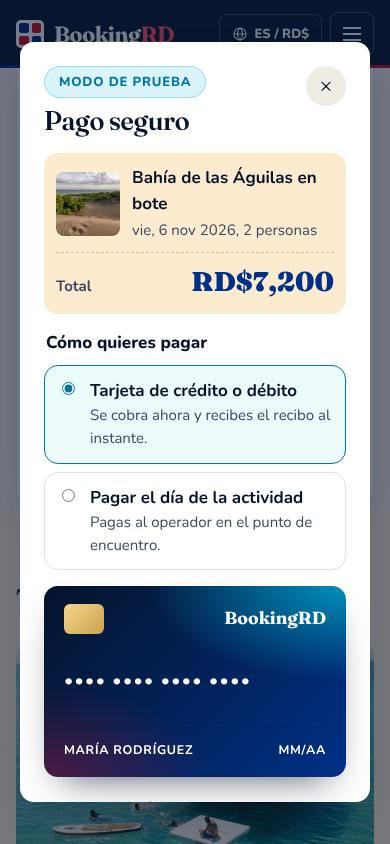 |
| Recibo | 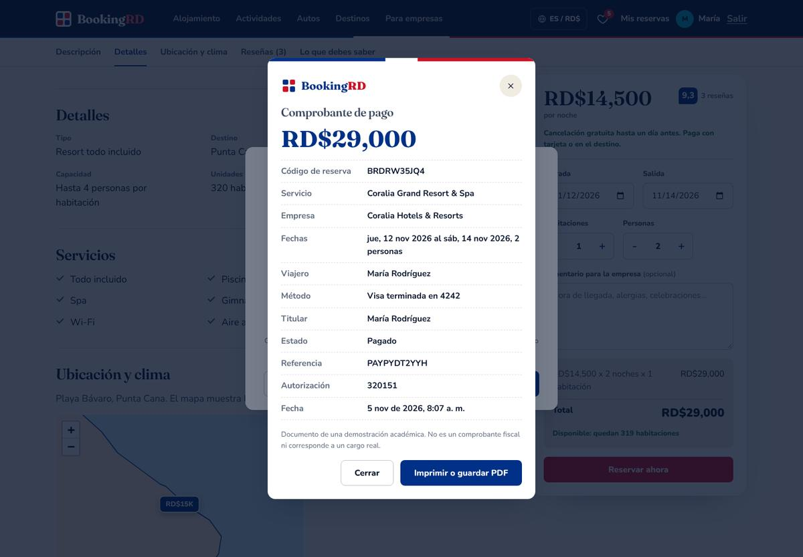 | |
| Alquiler de autos |  |  |
| Mis reservas | 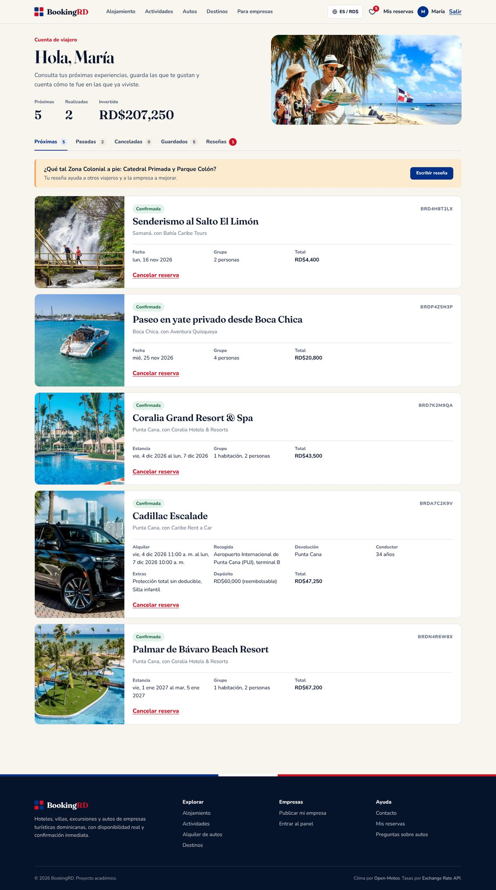 | |
| Panel de empresa |  | |
| Administración |  | |
| Inicio de sesión | 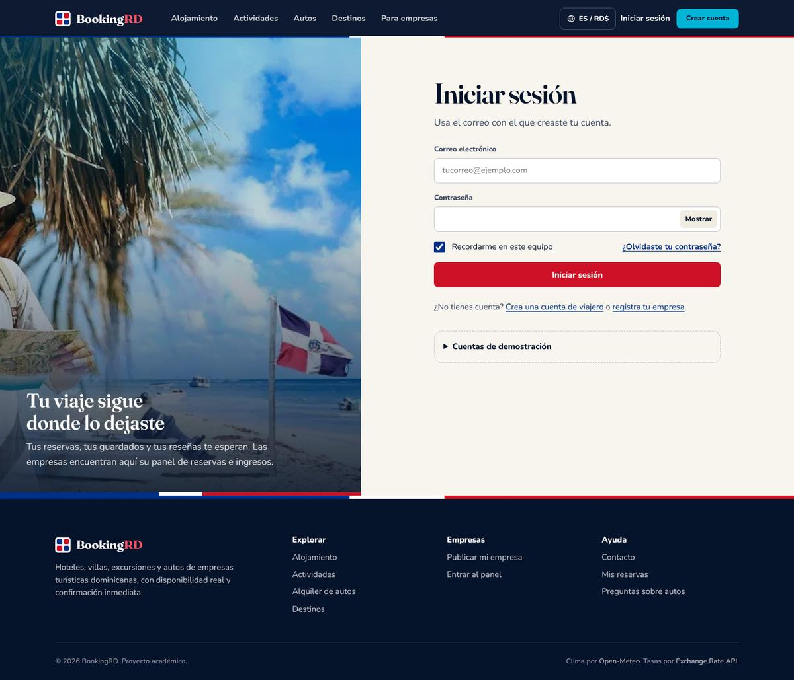 | |
| Registro de viajero |  | |
| Registro de empresa |  | |
| Correos | 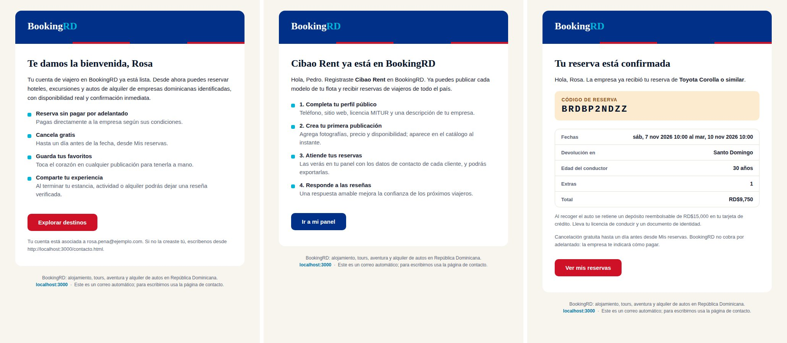 | |

---

## 3. Base de datos permanente

### 3.A Azure SQL Database (recomendado para el equipo)

Una sola base compartida: lo que publica o reserva un integrante lo ven los demás. Azure SQL Database tiene una oferta gratuita (100.000 vCore-segundos y 32 GB al mes por base) con pausa automática al agotarla; es compatible con *Azure for Students* y con la cuenta gratuita de Azure.

**Crear la base (una vez, un integrante):**

1. En <https://portal.azure.com>, busca **SQL databases > Create** y selecciona **Apply offer** en el aviso de la oferta gratuita.
2. *Basics*: grupo de recursos nuevo (p. ej. `bookingrd-rg`), base `BookingRD`, servidor nuevo con **SQL authentication** (anota usuario y contraseña) y *Behavior when free limit reached*: **Auto-pause the database until next month**.
3. *Networking*: **Public endpoint** y **Add current client IP address**.
4. *Review + create > Create*.
5. En la carpeta del proyecto:

   ```bash
   npm run configurar
   ```

   El asistente pide el servidor, el usuario y la contraseña, genera `.env`, prueba la conexión (si el firewall la rechaza, indica la IP que debes autorizar) y crea las tablas con los datos de demostración.

6. Comparte el `.env` con el equipo por un canal privado. **Nunca lo subas al repositorio.**

**Resto del equipo:** copia el `.env` en la raíz del proyecto, autoriza tu IP (*SQL server > Security > Networking > Add your client IPv4 address > Save*) y verifica con `npm run bd:probar`.

Con la pausa automática, la primera conexión tras un rato sin uso puede tardar hasta un minuto. Basta con reintentar.

**Instalar a mano:** también puedes abrir `database/instalacion-azure.sql` en SSMS, en Azure Data Studio o en el *Query editor* del portal, conectado a la base `BookingRD`, y ejecutarlo completo.

### 3.B SQL Server local

**Automático (Windows):** `INICIAR-BookingRD.bat` lo hace la primera vez, y `npm run sqlserver` lo repite cuando quieras (sección 1.2). Usa `scripts/sqlserver-windows.ps1`.

**A mano, con SQL Server Management Studio:**

1. Instala SQL Server Express o Developer y SSMS.
2. Conectado con tu cuenta de Windows, abre y ejecuta (F5) `database/habilitar-sqlserver.sql`: activa la autenticación de SQL Server y TCP/IP en el puerto 1433.
3. Reinicia el servicio de SQL Server (en SSMS, clic derecho sobre el servidor > *Reiniciar*, o en *Servicios* de Windows).
4. Abre y ejecuta `database/instalacion-completa.sql`. Crea la base `BookingRD`, el login `bookingrd_app` (contraseña `BookingRD#2026!`), las tablas y los datos.
5. Copia la plantilla de configuración y completa los valores de SQL Server local que trae comentados:

   ```bash
   copy .env.example .env
   ```

   Genera un `JWT_SECRET` con `node -e "console.log(require('crypto').randomBytes(48).toString('hex'))"`.

### 3.C Comandos de base de datos

| Comando | Qué hace |
|---|---|
| `npm run bd:probar` | Prueba la conexión y cuenta los registros de cada tabla |
| `npm run bd:instalar` | Crea lo que falte y carga los datos de demostración. Idempotente: no duplica datos ni borra lo creado por el equipo |
| `npm run bd:reiniciar` | Elimina las tablas de BookingRD y las vuelve a instalar (pide confirmación). Úsalo si la base tiene tablas de una versión anterior |
| `npm run bd:generar` | Regenera los dos scripts SQL a partir de `database/esquema.sql` y `database/datos-demo.js` |

Las fechas de las reservas de ejemplo se calculan al instalar, así que siempre hay reservas próximas y un historial con reseñas.

> El script SQL se validó automáticamente (cada inserción resuelve sus claves y los conteos coinciden), pero esta versión aún no se ha ejecutado contra un SQL Server o una base de Azure reales. Ejecuta `npm run bd:instalar` y `npm run bd:probar` la primera vez y revisa la salida.

---

## 4. Configuración (`.env`)

La plantilla comentada está en `.env.example`. Variables principales:

| Variable | Uso |
|---|---|
| `DB_SERVER`, `DB_DATABASE`, `DB_USER`, `DB_PASSWORD`, `DB_PORT`, `DB_INSTANCE`, `DB_TRUST_CERT` | Conexión a la base. Sin `DB_SERVER`, base local en archivo (`database/local/`) |
| `DB_MODO=demo` | Demostración en memoria que no guarda cambios (lo usan `npm run demo` y las pruebas) |
| `JWT_SECRET`, `JWT_EXPIRES_IN` | Firma y duración de las sesiones |
| `PORT` | Puerto del servidor (3000) |
| `LIMITE_INTENTOS_AUTH` | Intentos de inicio de sesión por IP cada 10 minutos |
| `SMTP_HOST`, `SMTP_PORT`, `SMTP_USUARIO`, `SMTP_CLAVE`, `CORREO_REMITENTE`, `URL_SITIO` | Envío de correos (Gmail: contraseña de aplicación en <https://myaccount.google.com/apppasswords>; Outlook: `smtp-mail.outlook.com`, puerto 587) |

## 5. Trabajo en equipo con GitHub

Repositorio: <https://github.com/gsanchez47-tech/BookingRD>.

```bash
git pull
git checkout -b nombre-de-rama
git add .
git commit -m "Descripción del cambio"
git push -u origin nombre-de-rama   # y abrir un Pull Request
```

Fuera del repositorio (`.gitignore`): `node_modules/`, `.env`, `correos-enviados/`, `database/local/` y registros.

## 6. Estructura

```
BookingRD/
├── frontend/                 Fuente de las páginas
│   ├── paginas/*.html        Contenido de cada página
│   ├── partes/               Cabeza, encabezado, pie y ventana de pago comunes
│   └── estilos/              base.css, una hoja por página y compartidos/
├── public/                   Sitio servido por Express (generado + recursos)
│   ├── *.html, css/          Generados con npm run construir: no editar a mano
│   ├── js/                   comun.js, preferencias.js (idioma y moneda),
│   │                         idioma-en.js, pagos.js (pago simulado y recibo),
│   │                         isla.js (mapa SVG), lugares.js (imperdibles),
│   │                         combos-comun.js (tarjeta de combo), clima.js,
│   │                         buscador.js, mapa.js y uno por página
│   ├── img/                  destinos/, paginas/, publicaciones/, servicios/,
│   │                         productos/ (tienda) y mini/ (copias de 640 px)
│   ├── fonts/                Fraunces y Nunito (licencia OFL)
│   └── vendor/               Leaflet 1.9.4 y Leaflet.markercluster 1.5.3 (mapas)
├── src/
│   ├── server.js             Express: seguridad, rutas, estáticos y errores
│   ├── config/               Conexión SQL, modo de datos y correo
│   ├── routes/ controllers/ services/ validators/ middleware/ utils/
│   └── repositories/         SQL (*.repo.js) y memoria/ (base local en archivo)
├── database/
│   ├── esquema.sql           Tablas e índices
│   ├── datos-demo.js         Datos de ejemplo (fuente única)
│   ├── habilitar-sqlserver.sql    TCP/IP y autenticación mixta en SQL Server local
│   ├── instalacion-completa.sql   SQL Server local (crea base y login)
│   ├── instalacion-azure.sql      Azure SQL Database
│   └── local/                Base local en archivo (se crea al usarla; no se versiona)
├── scripts/                  iniciar, sqlserver-windows.ps1, configurar, bd,
│                             local-reiniciar, demo, generar-sql, construir-frontend
├── INSTALAR-BookingRD.bat    Instalación completa en C:\BookingRD con SQL Server (Windows)
├── INICIAR-BookingRD.bat     Arranque con doble clic (Windows)
├── DESINSTALAR-BookingRD.bat Quita C:\BookingRD, sus accesos y la base BookingRD
├── pruebas/api.test.js       Pruebas de la API
└── docs/                     Documentación técnica, resumen y capturas
```

Para cambiar el diseño, edita `frontend/` y ejecuta `npm run construir`. Los cambios en `public/js/` no necesitan ese paso.

Documentación técnica: [`docs/DOCUMENTACION.md`](docs/DOCUMENTACION.md). Guion de la demostración: [`docs/GUIA-DEMOSTRACION.md`](docs/GUIA-DEMOSTRACION.md). Guía paso a paso de Azure: [`docs/GUIA-AZURE.md`](docs/GUIA-AZURE.md). Resumen en una página: [`docs/RESUMEN.md`](docs/RESUMEN.md).

## 7. Solución de problemas

| Síntoma | Causa probable | Qué hacer |
|---|---|---|
| `'npm' no se reconoce como un comando` | Node.js no está instalado o la terminal se abrió antes de instalarlo | Instala Node.js LTS y abre una terminal nueva |
| `Error: listen EADDRINUSE :::3000` | Ya hay un servidor en el puerto 3000 | Cierra la otra terminal o pon `PORT=3001` en `.env` |
| Aviso "El servidor de BookingRD no está en ejecución" | Se abrió un HTML con doble clic, o se cerró la ventana negra | Doble clic en `INICIAR-BookingRD.bat` y entra a <http://localhost:3000> |
| Página sin estilos o el `.bat` no encuentra archivos | Se abrió desde dentro del `.zip` | Extrae el `.zip` primero |
| La consola dice "Base de datos local" en lugar de SQL Server | No se configuró SQL Server o el servicio no respondió | `npm run sqlserver`; revisa que el servicio *SQL Server (SQLEXPRESS)* esté iniciado en *Servicios* |
| "Se canceló el permiso de administrador" | Se respondió *No* a la ventana de Windows | `npm run sqlserver` y acepta el permiso |
| "SQL Server no acepta conexiones en el puerto 1433" | Otra instancia de SQL Server ya usa ese puerto | Usa esa instancia (configúrala a mano, sección 3.B) o detén la otra en *Servicios* y repite `npm run sqlserver` |
| "No se pudo entrar a SQL Server con tu cuenta de Windows" | Tu usuario no es administrador de esa instancia | Ejecuta con el usuario que instaló SQL Server, o sigue la sección 3.B con un administrador |
| Clima sin datos o moneda con tasa de referencia | Sin conexión a internet o servicio externo caído | El sitio sigue funcionando; se actualiza cuando vuelva la conexión |
| "El servicio no está disponible en este momento" | Sin conexión con la base, o Azure reanudándose | Reintenta en un minuto; si sigue, `npm run bd:probar` |
| `Cannot open server ... requested by the login` | Tu IP no está autorizada en Azure | Agrégala en *Networking > Firewall rules* |
| `Login failed for user` | Usuario o contraseña incorrectos | Revisa `DB_USER` y `DB_PASSWORD` |
| `Invalid column name` tras instalar | La base tiene tablas de una versión anterior | `npm run bd:reiniciar` |
| `CHECK constraint` al publicar en Miches, Barahona, Montecristi o Baní | La base se instaló antes de agregar esos destinos | `npm run bd:reiniciar` (o `npm run sqlserver` y responder *s*) |
| `Failed to connect to localhost:1433` | TCP/IP deshabilitado o servicio detenido | `npm run sqlserver`, o ejecuta `database/habilitar-sqlserver.sql` y reinicia el servicio |
| "Demasiados intentos" | Límite de inicios de sesión por IP | Espera 10 minutos o sube `LIMITE_INTENTOS_AUTH` |
