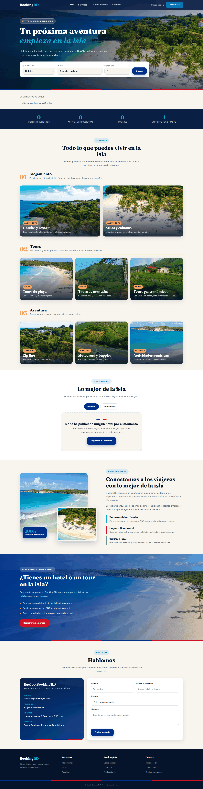
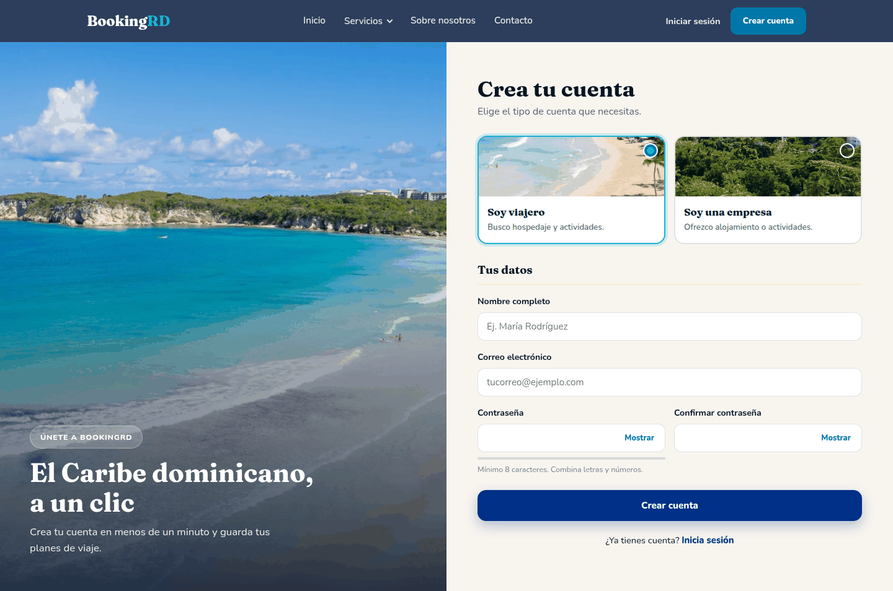
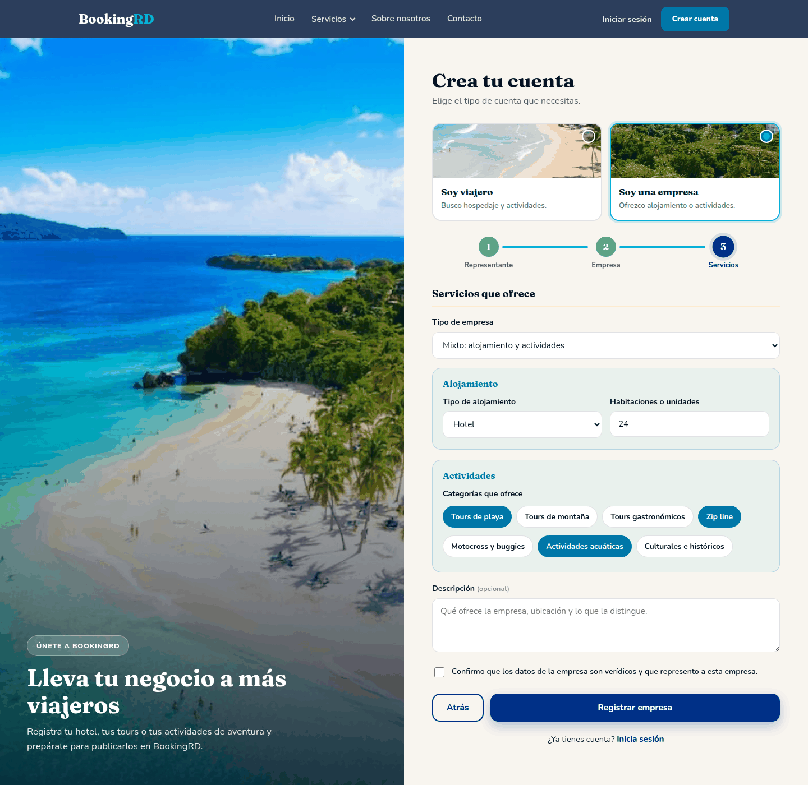
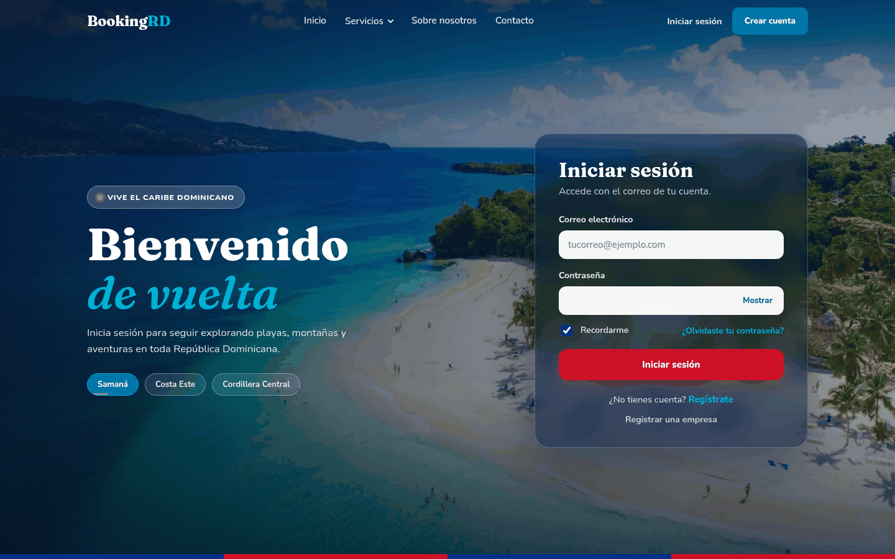

# BookingRD

Plataforma web de hoteles y actividades turísticas en República Dominicana. Proyecto académico, Fase 1.

| Capa | Tecnología |
|---|---|
| Backend | Node.js 18+ y Express 4 |
| Base de datos | Azure SQL Database (compartida por el equipo) o SQL Server 2019+ local, mediante el paquete `mssql` |
| Frontend | HTML, CSS y JavaScript sin frameworks ni herramientas de compilación |
| Autenticación | bcrypt (hash de contraseñas) y JWT (sesiones) |

**Alcance de la Fase 1:**

- **Inicio:** buscador, indicadores, menú *Servicios* por categoría (alojamiento, tours y aventura), vitrina fotográfica de servicios, publicaciones, *Sobre nosotros* y *Contacto* con formulario que se guarda en la base de datos. El sitio arranca sin hoteles ni actividades publicados y lo indica.
- **Registro:** sencillo para viajeros (nombre, correo y contraseña) y en tres pasos para empresas (representante, datos legales y servicios). La empresa elige *Alojamiento*, *Actividades* o *Mixto* y el formulario habilita los campos correspondientes.
- **Inicio de sesión:** fotografía a pantalla completa con transición automática, tarjeta translúcida, opción *Recordarme* y ayuda para recuperar la contraseña.

Documentación adicional:
- [`docs/RESUMEN.md`](docs/RESUMEN.md): estado del proyecto en una página.
- [`docs/DOCUMENTACION.md`](docs/DOCUMENTACION.md): arquitectura, API, base de datos, frontend y pruebas.

---

## Capturas

Cada captura lleva el nombre del archivo HTML que muestra (vista de escritorio, 1440 px).

### Inicio · `public/index.html`



### Registro de viajero · `public/registro.html`



### Registro de empresa · `public/registro.html?tipo=empresa` (paso 3, empresa mixta)



### Inicio de sesión · `public/login.html`



> Las fotografías de `public/img/servicios/` son provisionales para algunas categorías (tours gastronómicos, zip line y motocross). Para cambiarlas basta con reemplazar el archivo por otro con el mismo nombre (`tour-gastronomico.jpg`, `zip-line.jpg`, `motocross.jpg`, etc.), preferiblemente de 800 x 600 px.

---

## 1. Requisitos

- [Node.js](https://nodejs.org) 18 o superior (versión LTS recomendada).
- [Git](https://git-scm.com).
- Acceso a la base de datos: la base compartida en Azure (sección 3.A) o un SQL Server local (sección 3.B).

No se requieren herramientas de compilación: `bcrypt` 6 incluye binarios precompilados para Windows, macOS y Linux.

## 2. Obtener el proyecto

```bash
git clone https://github.com/<usuario-u-organizacion>/BookingRD.git
cd BookingRD
npm install
```

## 3. Base de datos

### 3.A Base compartida en Azure SQL Database (recomendado)

Una sola base para todo el equipo. Todos los integrantes usan la misma configuración, por lo que cualquier registro nuevo es visible para todos de inmediato.

Azure ofrece una base de datos SQL gratuita por suscripción (100.000 vCore-segundos y 32 GB de almacenamiento por mes, con pausa automática al agotar el límite mensual).

**Creación (una sola vez, un integrante):**

1. Ingresar a <https://portal.azure.com>, buscar **SQL databases** y seleccionar **Create**. En la parte superior del formulario, aplicar la oferta gratuita (*Apply offer*).
2. Pestaña *Basics*:
   - *Resource group*: crear uno nuevo, p. ej. `bookingrd-rg`.
   - *Database name*: `BookingRD`.
   - *Server*: *Create new*. Elegir un nombre único, una región cercana y *Authentication method*: **Use SQL authentication**. Anotar el usuario y la contraseña de administrador.
   - *Behavior when free limit reached*: **Auto-pause the database until next month** (evita cargos).
3. Pestaña *Networking*: *Connectivity method*: **Public endpoint**; activar **Add current client IP address**.
4. *Review + create* > *Create*.
5. En la carpeta del proyecto, ejecutar el asistente y responder con los datos del servidor:

   ```bash
   npm run configurar
   ```

   El asistente genera el archivo `.env`, prueba la conexión (e indica la IP a autorizar si el firewall la rechaza) y crea las tablas y las cuentas de demostración.

6. Compartir el archivo `.env` con el equipo por un canal privado. **El archivo `.env` no se sube al repositorio.**

**Resto del equipo:**

1. Copiar en la raíz del proyecto el `.env` recibido (o ejecutar `npm run configurar` con los mismos datos del servidor).
2. Autorizar su IP pública en el portal: *SQL server > Security > Networking > Firewall rules > Add your client IPv4 address > Save*.
3. Verificar la conexión:

   ```bash
   npm run bd:probar
   ```

Con la pausa automática, la primera conexión después de un período sin uso puede tardar hasta un minuto y responder "servicio no disponible". Basta con reintentar.

### 3.B SQL Server local (alternativa sin conexión compartida)

1. Instalar SQL Server (Express o Developer) y SQL Server Management Studio.
2. Abrir `database/instalacion-completa.sql` en SSMS con un login administrador y ejecutar (F5). Crea la base `BookingRD`, el login `bookingrd_app`, las tablas y las cuentas de demostración.
3. Crear el archivo de configuración con los valores locales de la plantilla:

   ```bash
   cp .env.example .env        # Windows (cmd): copy .env.example .env
   ```

En esta modalidad cada integrante tiene su propia base y los datos no se comparten.

## 4. Ejecución

```bash
npm start          # ejecución normal
npm run dev        # desarrollo, con reinicio automático (nodemon)
```

Abrir <http://localhost:3000>.

Las páginas de `public/` también pueden abrirse con doble clic desde el explorador de archivos. Cada HTML enlaza su propia hoja de estilos, por lo que se ve con su diseño completo; los datos (indicadores, registro, inicio de sesión) se obtienen de `http://localhost:3000`, así que el servidor debe estar en ejecución.

> Si el proyecto se descargó como `.zip`, extraerlo primero (*Extraer todo*). Abrir un HTML directamente desde dentro del `.zip` impide que el navegador encuentre la carpeta `css/`.

### Cuentas de demostración

Creadas por `database/instalacion-completa.sql`:

| Tipo | Correo | Contraseña |
|---|---|---|
| Viajero | cliente@bookingrd.com | Cliente123! |
| Empresa mixta (Bahía Caribe Tours) | empresa@bookingrd.com | Empresa123! |

Los mensajes del formulario de contacto se consultan en la tabla `dbo.mensajes_contacto` (por ejemplo, desde el editor de consultas del portal de Azure).

## 5. Publicación en GitHub y trabajo en equipo

**Publicación inicial (un integrante):**

1. Crear en GitHub un repositorio vacío llamado `BookingRD` (sin README, `.gitignore` ni licencia).
2. Desde la carpeta del proyecto:

   ```bash
   git remote add origin https://github.com/<usuario>/BookingRD.git
   git push -u origin main
   ```

3. En GitHub: *Settings > Collaborators > Add people* e invitar a cada integrante.

**Flujo de trabajo de cada integrante:**

```bash
git pull                        # traer los cambios del equipo antes de trabajar
git checkout -b nombre-de-rama  # rama por tarea (recomendado)
git add .
git commit -m "Descripción del cambio"
git push -u origin nombre-de-rama   # y abrir un Pull Request en GitHub
```

Excluidos del repositorio (`.gitignore`): `node_modules/`, `.env`, registros y archivos del editor.

## 6. Estructura

```
BookingRD/
├── public/                         Frontend (servido por Express como archivos estáticos)
│   ├── index.html                  Página de inicio
│   ├── registro.html               Registro de viajero o de empresa
│   ├── login.html                  Inicio de sesión
│   ├── css/                        Una hoja de estilos por página (mismo nombre que el HTML)
│   ├── js/
│   │   ├── comun.js                Cliente de la API, sesión, header, menús, avisos y animaciones
│   │   ├── index.js                Indicadores, buscador, publicaciones, servicios y contacto
│   │   ├── registro.js             Registro de viajero y registro de empresa por pasos
│   │   └── login.js                Inicio de sesión y fondo animado
│   └── img/                        Fotografías del sitio
│       └── servicios/              Fotografías de cada categoría de servicio
├── src/
│   ├── server.js                   Punto de entrada de Express
│   ├── config/db.js                Pool de conexiones a SQL Server / Azure SQL
│   ├── routes/                     Definición de endpoints
│   ├── controllers/                Lógica de negocio (autenticación, catálogo y contacto)
│   ├── middleware/autenticacion.js Verificación del JWT
│   └── utils/                      Validaciones, catálogos de valores permitidos y errores asíncronos
├── database/
│   └── instalacion-completa.sql    Esquema y cuentas de demostración (idempotente)
├── scripts/
│   ├── configurar-azure.js         Asistente `npm run configurar`
│   └── bd.js                       Comandos `bd:instalar` y `bd:probar`
├── docs/                           Documentación y capturas
├── .env.example                    Plantilla de configuración
└── package.json
```

## 7. Solución de problemas

| Síntoma | Causa probable | Acción |
|---|---|---|
| `Falta JWT_SECRET` al iniciar | No existe `.env` | Ejecutar `npm run configurar` o copiar `.env.example` a `.env` |
| Página sin estilos | HTML abierto desde dentro del `.zip` | Extraer el `.zip` y abrir el HTML de la carpeta extraída |
| "No se pudo conectar con el servidor" en la página | El backend no está en ejecución | Ejecutar `npm start` |
| "El servicio no está disponible en este momento" | Sin conexión con la base de datos | Ejecutar `npm run bd:probar` y revisar el mensaje |
| `Cannot open server ... requested by the login` (Azure) | IP no autorizada en el firewall | Agregar la IP en *Networking > Firewall rules* |
| `Login failed for user` | Usuario o contraseña incorrectos | Revisar `DB_USER` y `DB_PASSWORD` en `.env` |
| `Failed to connect to localhost:1433` (local) | TCP/IP deshabilitado en SQL Server Express | *SQL Server Configuration Manager > Protocolos > TCP/IP: habilitado*, o usar `DB_INSTANCE=SQLEXPRESS` con `DB_PORT` vacío |
